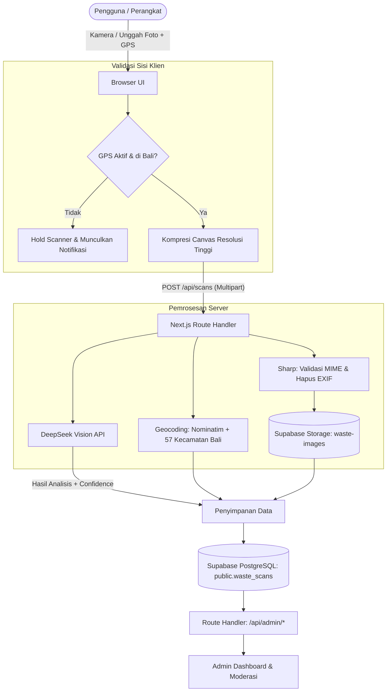

# BaliEcoGrade

Platform klasifikasi dan edukasi pemilahan sampah berbasis visi komputer (*computer vision*) dengan integrasi kearifan lokal Bali.

[](https://nextjs.org/)
[](https://react.dev/)
[](https://www.typescriptlang.org/)
[](https://supabase.com/)
[](https://tailwindcss.com/)
[](LICENSE)

---

## Daftar Isi

- [Problem & Target User](#problem--target-user)
- [Key Features](#key-features)
- [Tech Stack](#tech-stack)
- [AI Implementation](#ai-implementation)
- [Architecture & Data Flow](#architecture--data-flow)
- [Run Instructions](#run-instructions)
- [Deployment URL](#deployment-url)
- [Team Members](#team-members)
- [Known Limitations](#known-limitations)
- [Third-party Resources](#third-party-resources)

---

## Problem & Target User

### Latar Belakang & Masalah
* **Tingkat Pemilahan di Sumber Rendah**: Kurangnya kesadaran dan pemahaman praktis masyarakat mengenai pemilahan sampah berbasis sumber (organik, anorganik, residu, dan B3) yang berakibat pada kelebihan beban di tempat pembuangan akhir di Bali.
* **Karakteristik Sampah Upacara Adat**: Keunikan komposisi sampah upacara (seperti canang sari, daksina, dan janur) yang sering kali tercampur material non-organik (staples, pembungkus plastik sachet, atau sisa lilin/dupa), sehingga menghambat proses komposting dan daur ulang.
* **Keraguan Identifikasi Fisik**: Kesulitan masyarakat membedakan material yang tampak mirip namun berbeda penanganan, seperti kertas bersih yang dapat didaur ulang versus kertas pembungkus makanan berminyak yang masuk kategori residu.

### Pengguna yang Dituju
* **Masyarakat & Rumah Tangga di Bali**: Panduan praktis pemilahan sampah harian dan sisa sarana upacara di tingkat banjar dan desa.
* **Pengelola TPS3R & Bank Sampah**: Verifikasi cepat kategori material dan sarana edukasi bagi warga.
* **Wisatawan & Pelaku Usaha**: Membantu kepatuhan terhadap regulasi pengelolaan sampah berbasis sumber di Provinsi Bali.
* **Administrator Lingkungan Hidup**: Pengawasan tren volume pemindaian per wilayah, verifikasi data, dan audit data lapangan.

---

## Key Features

1. **AI Waste Scanner (Kamera & Galeri)**
   * Pengambilan foto langsung melalui kamera gawai atau unggahan dari penyimpanan berkas.
   * Pipeline pra-pemrosesan gambar (kompresi client, normalisasi ukuran, dan pembersihan metadata EXIF di server).
2. **Klasifikasi 4 Kategori Resmi**
   * **ORGANIK**: Sisa makanan, daun, buah, canang sari/bunga upacara murni tanpa bahan sintetis.
   * **ANORGANIK**: Botol plastik bersih, kaleng, kardus kering, botol kaca.
   * **RESIDU**: Kertas minyak bekas makanan, kemasan sachet multilapis kotor, popok, styrofoam kotor, sisa abu dupa.
   * **B3**: Baterai bekas, bohlam/neon, wadah pestisida, limbah kimia rumah tangga.
3. **Konteks Budaya & Kearifan Lokal Bali**
   * Instruksi spesifik pemisahan material sintetis (misal staples dan plastik pembungkus) dari bahan organik upacara sebelum diolah menjadi kompos.
4. **Validasi Geolocation Bali (Scanner Hold)**
   * Reverse geocoding terintegrasi (kombinasi OSM Nominatim dan dataset referensi 57 kecamatan se-Bali).
   * Scanner otomatis ditahan (*hold*) apabila izin lokasi ditolak atau koordinat pengguna berada di luar batas wilayah Provinsi Bali.
5. **Admin Dashboard & Kontrol Kualitas Data**
   * Ringkasan analitik: total pemindaian, rasio kategori, dan sebaran pemindaian per kabupaten/kota.
   * Log pemindaian lengkap dengan penampil citra dari penyimpanan privat Supabase Storage.
   * Moderasi Admin: Kemampuan mengoreksi hasil klasifikasi (*false detection*), memperbarui status verifikasi (*approved/rejected*), dan menyunting instruksi pembuangan.
   * Filter ganda: tampilan default (sampah valid terdeteksi) dan tampilan penuh (mencakup hasil *uncertain*/non-sampah).
   * Fitur seleksi massal (*select all*) dan penghapusan cepat (*quick deletion*) untuk membersihkan data non-sampah beserta file gambarnya.
   * Ekspor data terfilter ke format CSV (UTF-8 dengan mitigasi injeksi formula spreadsheet).

---

## Tech Stack

| Lapisan | Teknologi | Keterangan |
|---|---|---|
| **Frontend** | Next.js 16 (App Router), React 19 | Server & Client Components, arsitektur modern |
| **Styling** | Tailwind CSS v4, Lucide React | Tampilan responsif, dark mode native, ikon UI |
| **Backend** | Next.js Route Handlers | Serverless API endpoints di Vercel |
| **Image Processing** | Sharp | Validasi MIME type, resizing, dan pembersihan EXIF |
| **Database** | Supabase (PostgreSQL 17) | Relasional, Row Level Security (RLS), indeks komposit |
| **Storage** | Supabase Storage | Bucket privat `waste-images` dengan signed URL sementara |
| **AI Vision** | DeepSeek Vision API | Ekstraksi fitur visual dan klasifikasi multimodal |
| **Hosting** | Vercel | CI/CD otomatis terintegrasi repository GitHub |

---

## AI Implementation

Aplikasi menggunakan **DeepSeek Vision API** (`deepseek-flash`) yang dijalankan sepenuhnya di sisi server (*server-side*) untuk menjaga keamanan kredensial API.

### Alur Kerja Model
1. **Analisis Kondisi Fisik**: Mengevaluasi kondisi visual material—seperti tingkat kebersihan, kontaminasi minyak atau sisa makanan, serta adanya lapisan laminasi plastik.
2. **Kategorisasi & Scoring**: Menghasilkan kategori kanonik (`ORGANIK`, `ANORGANIK`, `RESIDU`, `B3`) disertai nilai tingkat keyakinan (*confidence score*) numerik 0.0 hingga 1.0.
3. **Deteksi Non-Sampah / Uncertain**: Jika citra buram atau bukan merupakan objek sampah, model menandai `analysis_status: "uncertain"` (`category: null`) untuk memicu dialog informasi bagi pengguna.
4. **Instruksi & Konteks Budaya**: Menyediakan alasan klasifikasi, instruksi keselamatan praktis, dan catatan adat lokal Bali tanpa halusinasi fakta budaya.

> [!NOTE]
> Ambang batas keyakinan standar disetel pada `WASTE_CLASSIFICATION_CONFIDENCE_THRESHOLD = 0.70`. Hasil pemindaian dengan skor di bawah ambang batas ini secara otomatis ditandai untuk ditinjau oleh administrator (`review_status: "pending"`).

---

## Architecture & Data Flow



---

## Run Instructions

### 1. Kloning Repository & Instalasi Dependensi
```bash
git clone https://github.com/baliecograde/baliecograde-new.git
cd baliecograde-new
npm install
```

### 2. Konfigurasi Variabel Lingkungan
Salin berkas `.env.example` ke `.env.local`:
```bash
cp .env.example .env.local
```

Isi variabel lingkungan berikut di `.env.local`:
```env
NEXT_PUBLIC_SUPABASE_URL=https://<project-ref>.supabase.co
NEXT_PUBLIC_SUPABASE_PUBLISHABLE_KEY=<supabase-anon-key>
SUPABASE_SECRET_KEY=<supabase-service-role-key>
DEEPSEEK_API_KEY=<deepseek-api-key>
DEEPSEEK_MODEL=deepseek-flash
WASTE_CLASSIFICATION_CONFIDENCE_THRESHOLD=0.70
SCAN_API_ENABLED=true
```

> [!IMPORTANT]
> `SUPABASE_SECRET_KEY` adalah *service_role* key yang hanya boleh berada di server. Jangan pernah memasukkan key ini ke variabel berawalan `NEXT_PUBLIC_` atau membagikannya ke publik.

### 3. Migrasi Database Supabase
Jalankan berkas migrasi SQL secara berurutan melalui SQL Editor pada dashboard Supabase:
1. `supabase/migrations/20261104000100_create_waste_scans_and_private_storage.sql`
2. `supabase/migrations/20261105000100_grant_delete_on_waste_scans.sql`

### 4. Menjalankan Server Development
```bash
npm run dev
```
Aplikasi dapat diakses melalui peramban di `http://localhost:3000`.

### 5. Validasi & Pengujian
```bash
# Menjalankan unit test
npm test

# Menjalankan typecheck & linting
npm run typecheck
npm run lint

# Menjalankan uji kompilasi produksi
npm run build
```

---

## Deployment URL

* **Aplikasi Utama**: [https://baliecograde-new.vercel.app](https://baliecograde-new.vercel.app)
* **Portal Admin**: [https://baliecograde-new.vercel.app/admin-login](https://baliecograde-new.vercel.app/admin-login)

---

## Team Members

| Nama | Peran | Fokus Tanggung Jawab |
|---|---|---|
| **I Gede Krusiawan Budi** | Fullstack & Backend Engineer | Arsitektur API Next.js, integrasi Supabase (DB & Storage), pipeline geocoding wilayah Bali, serta sistem moderasi dashboard. |
| **Ida Bagus Geniastra Wirabhuana** | AI & Machine Learning Specialist | Rekayasa prompt visi DeepSeek, perumusan logika pemilahan sampah adat Bali, dan benchmark akurasi klasifikasi. |
| **Angga Arditya** | Frontend & UI/UX Developer | Antarmuka interaktif pemindai kamera, visualisasi analitik chart dashboard, serta integrasi responsif Tailwind CSS. |

---

## Known Limitations

1. **Sensitivitas Citra Visual**: Tingkat akurasi deteksi model dipengaruhi oleh kejernihan fokus kamera, sudut pandang objek, dan kecukupan pencahayaan saat pengambilan foto.
2. **Pembatasan Geografis**: Fitur pemindaian aktif dibatasi khusus pada wilayah geografis Provinsi Bali. Pengguna di luar Bali atau yang menolak izin akses lokasi tidak dapat melakukan pemindaian.
3. **Ketergantungan Layanan Pihak Ketiga**: Waktu respons pemrosesan bergantung pada latensi inferensi DeepSeek Vision API dan ketersediaan layanan reverse-geocoding OpenStreetMap Nominatim.

---

## Third-party Resources

* **Layanan AI**: [DeepSeek Vision API](https://platform.deepseek.com/)
* **Basis Data & Cloud Storage**: [Supabase](https://supabase.com/)
* **Geocoding & Reverse Geocoding**: [OpenStreetMap Nominatim](https://nominatim.openstreetmap.org/)
* **Dataset Referensi**: Data koordinat 57 kecamatan dan 9 kabupaten/kota Provinsi Bali
* **Pustaka Utama**: Next.js, React, Sharp, Tailwind CSS, Lucide Icons
