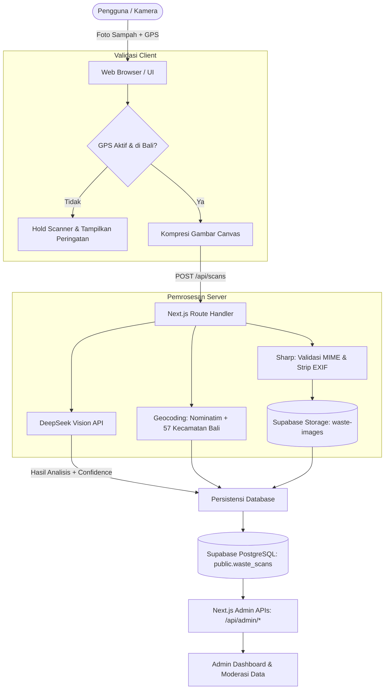

# BaliEcoGrade 🌿♻️
> **Platform Klasifikasi dan Edukasi Pemilahan Sampah Berbasis AI Vision dengan Kearifan Lokal Bali**

BaliEcoGrade adalah aplikasi berbasis web yang memanfaatkan teknologi AI Vision untuk mendeteksi material sampah, mengklasifikasikannya ke dalam 4 kategori resmi, serta memberikan panduan pemilahan praktis yang terintegrasi dengan konteks adat dan budaya Bali.

---

## 📌 Problem & Target User

### Masalah (Problem)
* **Pencemaran & Pemilahan di Sumber Rendah**: Kurangnya pemahaman masyarakat mengenai pemilahan sampah organik, anorganik, residu, dan B3 yang memperparah beban TPA di Bali (seperti TPA Suwung).
* **Karakteristik Sampah Khas Bali**: Keunikan sampah upacara adat (canang sari, daksina, janur) yang sering kali tercampur dengan plastik, staples, lilin, atau dupa, menyulitkan proses pengomposan maupun daur ulang.
* **Keraguan Kontaminasi Fisik**: Kebingungan masyarakat dalam memilah material seperti kertas minyak kotor vs kertas bersih, wadah makanan berminyak, atau plastik multilapis.

### Pengguna yang Dituju (Target User)
* **Masyarakat Umum & Rumah Tangga di Bali**: Untuk panduan pemilahan sampah harian dan sisa upacara adat di banjar/desa.
* **Pengelola TPS3R & Bank Sampah**: Sebagai alat verifikasi kategori dan edukasi pemilahan kepada nasabah.
* **Wisatawan & Pelaku Usaha**: Membantu mematuhi regulasi pengelolaan sampah berbasis sumber di Provinsi Bali.
* **Admin / Dinas Lingkungan Hidup**: Untuk pemantauan data pemindaian, statistik sebaran wilayah, dan verifikasi kualitas data.

---

## ✨ Key Features

1. **AI Waste Scanner (Kamera & Galeri)**
   * Unggah atau ambil foto sampah secara langsung via kamera perangkat.
   * Kompresi dan normalisasi gambar di sisi client dan server untuk performa cepat.
2. **4 Kategori Klasifikasi Resmi**
   * **ORGANIK**: Sisa makanan, daun, buah, canang sari/bunga sisa upacara murni.
   * **ANORGANIK**: Botol plastik bersih, kaleng, kardus kering, kaca.
   * **RESIDU**: Kertas minyak bekas makanan, sachet multilayer kotor, popok, styrofoam kotor, sisa abu dupa.
   * **B3**: Baterai bekas, lampu neon, botol pestisida/kimia, limbah elektronik.
3. **Konteks Budaya & Kearifan Lokal Bali**
   * Rekomendasi khusus penanganan sarana upacara (misal: memisahkan staples/plastik dari janur dan bunga sebelum dikomposkan).
4. **Validasi Geolocation Bali (Scanner Hold)**
   * Reverse geocoding terintegrasi (OSM Nominatim + fallback 57 kecamatan se-Bali).
   * Scanner otomatis ditahan (*hold*) apabila izin GPS ditolak atau pengguna berada di luar wilayah Provinsi Bali.
5. **Admin Dashboard & Verifikasi False Detection**
   * Metrik real-time: total pemindaian, rasio kategori (donut chart), dan sebaran pemindaian per kabupaten/kota (bar chart).
   * Audit log pemindaian lengkap dengan preview foto dari private storage.
   * Moderasi Admin: Kemampuan mengoreksi salah klasifikasi (*false detection*) AI, mengubah status verifikasi (*approved/rejected*), dan mengoreksi instruksi.
   * Filter ganda (default hanya sampah vs full include non-sampah/uncertain).
   * Fitur *Select All Uncertain* dan *Quick Deletion* untuk membersihkan pemindaian non-sampah beserta file gambarnya.
   * Ekspor data terfilter ke format CSV UTF-8.

---

## 🛠️ Tech Stack

| Lapisan | Teknologi |
|---|---|
| **Frontend** | [Next.js 16](https://nextjs.org/) (App Router), [React 19](https://react.dev/), [Tailwind CSS v4](https://tailwindcss.com/), [Lucide React](https://lucide.dev/) |
| **Backend** | Next.js Route Handlers (Serverless Functions), [Sharp](https://sharp.pixelplumbing.com/) (Image Processing & EXIF Sanitization) |
| **Database & Storage** | [Supabase](https://supabase.com/) PostgreSQL 17, Supabase Private Storage (`waste-images`), Row Level Security (RLS) |
| **AI / Machine Learning** | [DeepSeek Vision API](https://platform.deepseek.com/) (`deepseek-flash`) |
| **Hosting & Deployment** | [Vercel](https://vercel.com/) |

---

## 🤖 AI Implementation

* **Model**: DeepSeek Vision API (default: `deepseek-flash`).
* **Metode & Fungsi**:
  1. **Visual Feature Extraction**: Menganalisis kondisi fisik objek (kebersihan, kontaminasi minyak/makanan, kelembapan, lapisan plastik).
  2. **Categorization & Confidence Scoring**: Mengembalikan kategori kanonik (`ORGANIK`, `ANORGANIK`, `RESIDU`, `B3`) beserta nilai confidence score numerik (skala 0.0 – 1.0).
  3. **Uncertainty & Non-Waste Detection**: Jika objek buram, tidak jelas, atau bukan sampah, model menandai `analysis_status: "uncertain"` (`category: null`) sehingga sistem dapat menampilkan dialog edukasi ke pengguna.
  4. **Localized Reasoning**: Menghasilkan alasan klasifikasi ringkas, instruksi pembuangan aman, dan catatan adat lokal Bali tanpa halusinasi konteks budaya.
* **Ambang Batas Moderasi**: Nilai keyakinan di bawah ambang batas (`WASTE_CLASSIFICATION_CONFIDENCE_THRESHOLD = 0.70`) otomatis masuk antrean tinjauan admin (`review_status: "pending"`).

---

## 🔄 Architecture / Data Flow



---

## 🚀 Run Instructions (Local Setup)

### 1. Prasyarat
* Node.js v20+ atau v22+
* Akun [Supabase](https://supabase.com/) dan API Key [DeepSeek](https://platform.deepseek.com/)

### 2. Kloning Repository & Instalasi
```bash
git clone https://github.com/baliecograde/baliecograde-new.git
cd baliecograde-new
npm install
```

### 3. Konfigurasi Environment Variables
Salin template konfigurasi `.env.example` ke `.env.local`:
```bash
cp .env.example .env.local
```
Lengkapi nilai pada file `.env.local`:
```env
NEXT_PUBLIC_SUPABASE_URL=https://<project-ref>.supabase.co
NEXT_PUBLIC_SUPABASE_PUBLISHABLE_KEY=<supabase-anon-key>
SUPABASE_SECRET_KEY=<supabase-service-role-key>
DEEPSEEK_API_KEY=<deepseek-api-key>
DEEPSEEK_MODEL=deepseek-flash
WASTE_CLASSIFICATION_CONFIDENCE_THRESHOLD=0.70
SCAN_API_ENABLED=true
```

### 4. Setup Database Supabase
Jalankan file migrasi yang tersedia di folder `supabase/migrations/` melalui SQL Editor di Supabase Dashboard:
1. `20261104000100_create_waste_scans_and_private_storage.sql` (membuat tabel `waste_scans`, RLS, dan bucket privat `waste-images`)
2. `20261105000100_grant_delete_on_waste_scans.sql` (memberi hak akses delete untuk service role)

### 5. Menjalankan Aplikasi
```bash
# Menjalankan server development
npm run dev

# Menjalankan unit tests
npm test

# Menjalankan typecheck & lint
npm run typecheck
npm run lint
```
Buka `http://localhost:3000` pada browser Anda.

---

## 🌐 Deployment URL

* **Production URL**: [https://baliecograde-new.vercel.app](https://baliecograde-new.vercel.app) *(atau tautan deployment Vercel aktif Anda)*
* **Admin Login**: [https://baliecograde-new.vercel.app/admin-login](https://baliecograde-new.vercel.app/admin-login)

---

## 👥 Team Members

| Nama | Peran | Tanggung Jawab Utama |
|---|---|---|
| **I Gede Krusiawan Budi** | Fullstack & Backend Engineer | Arsitektur Next.js API, integrasi Supabase Database & Storage, pipeline geocoding Bali, dan Admin Dashboard backend. |
| **Ida Bagus Geniastra Wirabhuana** | AI & Machine Learning Specialist | Desain prompt sistem DeepSeek Vision, perumusan parameter klasifikasi kearifan lokal Bali, dan benchmarking akurasi model. |
| **Angga Arditya** | Frontend & UI/UX Developer | Implementasi antarmuka landing page, alur interaktif scanner kamera, visualisasi chart admin dashboard, dan styling Tailwind CSS. |

---

## ⚠️ Known Limitations

1. **Ketergantungan Kualitas Citra**: Tingkat akurasi klasifikasi AI vision sangat dipengaruhi oleh pencahayaan, fokus kamera, dan tingkat kejelasan objek sampah dalam foto.
2. **Batasan Wilayah Operasional**: Fitur pemindaian saat ini dibatasi hanya untuk koordinat geografis di dalam batas Provinsi Bali (koordinat di luar Bali atau penolakan izin GPS akan menahan scanner).
3. **Ketergantungan API Eksternal**: Kinerja analisis bergantung pada waktu respons (latensi) server DeepSeek Vision dan reverse-geocoding OpenStreetMap Nominatim.

---

## 📚 Third-party Resources & Credits

* **Model AI**: [DeepSeek](https://www.deepseek.com/) (DeepSeek Vision API)
* **Basis Data & Cloud Storage**: [Supabase](https://supabase.com/) (PostgreSQL & Supabase Storage)
* **Layanan Peta & Geocoding**: [OpenStreetMap](https://www.openstreetmap.org/) & [Nominatim API](https://nominatim.org/)
* **Dataset Wilayah**: Data referensi koordinat 57 kecamatan dan 9 kabupaten/kota Provinsi Bali.
* **Library & Frameworks**: Next.js, React, Sharp, Tailwind CSS, Lucide React.
